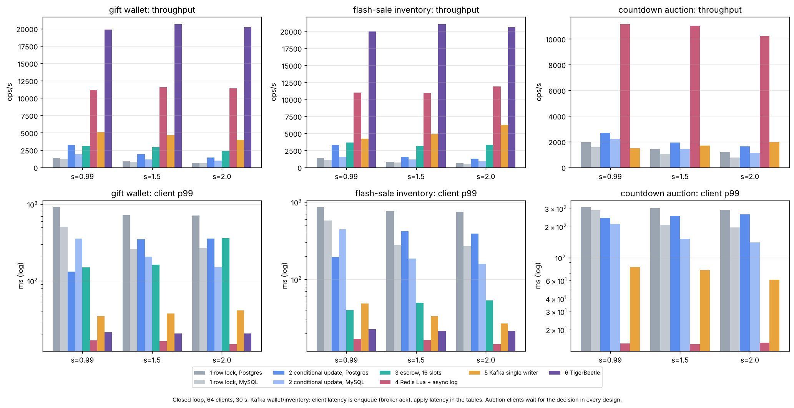
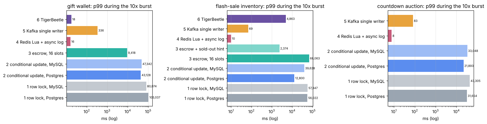

# HotLedger

A contended-state lab for TikTok LIVE. Six ways to keep hot-row state correct
when most users write the same few rows at once, on three LIVE semantics:

- **gift wallet**: commutative credits, exactly-once charges;
- **flash-sale inventory**: bounded decrements, no oversell, no lost sale;
- **countdown auction**: ordered, highest bid before the deadline wins,
  late bids extend the deadline (Countdown Bidding's Extended mode).

Every design runs the same skewed workload and the same 10x burst, is attacked
with the same faults, and is judged by the same history-based checker
(invariants for money and stock, linearizability for auctions).

| # | design | idea | semantics |
|---|---|---|---|
| 1 | `rowlock`, `mysql-rowlock` | `SELECT ... FOR UPDATE`, decide in Go, write, insert the idempotency record (Postgres 16 and MySQL 8 / InnoDB) | all three |
| 2 | `condupdate`, `mysql-condupdate` | one conditional statement (Postgres CTE, MySQL stored procedure) with the idempotency `INSERT` as arbiter | all three |
| 3 | `escrow` | hot accounts split into 16 slots: random-slot credits, bounded debits with a consolidating slow path, optional sold-out hint | wallet, inventory |
| 4 | `redislua` | atomic Lua script in Redis answers the client; a reconciler copies a Redis Stream into Postgres | all three |
| 5 | `kafka` | commands keyed by debit account (or auction); one writer per partition applies batches to Postgres with the offset in the same transaction | all three |
| 6 | `tigerbeetle` | TigerBeetle 0.17 as the reference ledger | wallet, inventory |

Everything is Go. The checker, the fault proxy, the load generator and the
orchestrator are part of the repo.

## Results

One 2-vCPU, 7 GB VM runs the databases, Redis, TigerBeetle, the broker, the
writers and the clients, so read the numbers as a comparison between designs,
not as capacity. Full tables: [`results/SUMMARY.md`](results/SUMMARY.md).
Method, invariants and the decision matrix: [`docs/DESIGN.md`](docs/DESIGN.md).
What surprised us: [`docs/FINDINGS.md`](docs/FINDINGS.md).



**Skew** (closed loop, 64 clients, 30 s, 1% duplicate submissions). At Zipf
s = 2.0 the hottest creator, SKU or auction receives about 61% of requests.
Throughput in ops/s, client p99 in ms:

| design | wallet | inventory | auction |
|---|---|---|---|
| 1 row lock, Postgres | 631 / 716 | 598 / 749 | 1,207 / 291 |
| 1 row lock, MySQL | 573 / 266 | 563 / 270 | 780 / 197 |
| 2 conditional update, Postgres | 1,403 / 356 | 1,259 / 391 | 1,626 / 264 |
| 2 conditional update, MySQL | 966 / 151 | 913 / 158 | 1,122 / 141 |
| 3 escrow, 16 slots | 2,383 / 362 | 3,307 / 53 | n/a |
| 4 Redis Lua + async log | 11,385 / 15 | 11,872 / 15 | 10,230 / 15 |
| 5 Kafka single writer | 3,997 / 41 | 6,231 / 27 | 1,956 / 62 |
| 6 TigerBeetle | 20,203 / 21 | 20,573 / 22 | n/a |

The async designs (4, 5) answer before the Postgres copy exists for the wallet
and inventory; their apply latency (reconciliation lag for design 4) is in the
full tables. For auctions the single writer waits for the writer's decision,
which is why it drops to 2k ops/s there. Row locking loses 54% of its wallet
throughput from s = 0.99 to 2.0; escrow loses 22%; Redis and TigerBeetle
are flat. The single writer is the noisiest design here: two identical wallet
runs at s = 2.0 gave 4.0k and 5.2k ops/s (each configuration ran once; the
noise note is at the top of the full tables). Server CPU per million wallet operations at s = 2.0:
TigerBeetle 27 s, Redis 100 s, single writer 305 s, escrow 613 s,
conditional update 1,029 s, row lock 2,267 s.

**10x burst** (open loop: 500 ops/s, then 5,000 ops/s for 10 s on two keys;
latency from each request's due time). Burst-phase p99:

| design | LIVE Match end (gifts) | flash sale (sells out) | auction end (sniping) |
|---|---|---|---|
| 1 row lock, Postgres | 103 s | 56 s | 31.7 s |
| 2 conditional update, Postgres | 43 s | 12.8 s | 21.9 s |
| 3 escrow, 16 slots | 9.4 s | 68 s | n/a |
| 3 escrow + sold-out hint | | 2.4 s | n/a |
| 4 Redis Lua + async log | 16 ms | 10 ms | 8 ms |
| 5 Kafka single writer | 336 ms | 69 ms | 83 ms |
| 6 TigerBeetle | 18 ms | 4.9 s | n/a |

Two things the burst shows that the skew runs do not:

- **Escrow is the best SQL design until the stock runs out, then the worst.**
  After a sell out every order fails its slot and takes the 16-slot
  consolidation path. A sold-out hint (the total a consolidation saw is an
  upper bound for an account that is only debited) brings the burst p99 from
  68 s to 2.4 s; the no-false-rejection invariant is what makes the shortcut
  safe.
- **Under sniping, the SQL designs refuse bids their bidders placed in time.**
  The conditional update refused 34,714 bids as
  closed, and 25,382 of them (73%) had been placed before the auction's final
  deadline: they queued behind the hot row and were stamped late. Redis and
  the single writer, which stamp the receive time before the queue, refused
  about 9,300 each, of which 3 and 6 were placed in time. The checker passes
  all of them, because linearizability is judged against the receive time the
  system stamped; the extra column is what shows the bidders lost.

**Faults.** 48 fault runs: 118 injected process and network faults
(Postgres crash with WAL recovery, MySQL and TigerBeetle `kill -9`, 4 s
partitions that deliver held bytes late, connection resets, writer `kill -9`
mid-batch, zombie writers stopped past their session timeout, rebalances,
broker and Redis `kill -9`, Redis failovers) plus 113,508 duplicate
submissions, 5.9M client operations checked.

| what failed | design | result |
|---|---|---|
| Postgres crash, MySQL `kill -9`, TigerBeetle `kill -9`, partitions, connection resets, writer `kill -9`, zombie writers, rebalances, duplicates | 1, 2, 3, 5, 6 | **0 violations**; the offset fence rejected every stale zombie batch |
| Redis `kill -9` (`appendfsync everysec`) | 4 | 229 acknowledged transfers lost in 1 of 3 runs |
| Redis failover to an async replica | 4 | 1 acknowledged transfer lost in 6 wallet runs; in 1 of 3 auction runs 7 accepted bids lost and 4 auctions non-linearizable (two bidders both told they led at 3,709) |
| Redis primary partitioned from its replica for 3 s, then failover | 4 | 23,336 acknowledged transfers lost; Redis and Postgres diverged; 8 accounts negative in Postgres |
| the same with `min-replicas-to-write 1` | 4 | 3,999 lost, none negative: bounded, not closed |

Recovery after a crash (median client outage, including the orchestrator's
2 s before it restarts the process): conditional update 4.0 s, TigerBeetle
4.0 s, row lock 6.4 s (and 11.7 s back to 90% throughput, against 2.7 s for
the conditional update). Wallet clients of the single writer never notice a
writer `kill -9` (they only enqueue), but bidders, who wait for the writer's
decision, saw an 11.6 s outage: the 6 s session timeout, then the rebalance.
In every zombie run the offset fence rejected the stale batches (3 to 5 per
run, 18 in all).

**The checker catches real bugs.** Five seeded bugs, all caught:

| seeded bug | caught as |
|---|---|
| wallet: `SELECT` without `FOR UPDATE` | I1 conservation, I4 on 30 accounts |
| wallet: `INSERT ... ON CONFLICT DO NOTHING` in the one-statement transfer | I4 on 928 accounts (balanced double charges: conservation alone misses them) |
| wallet: writer dedupes the record but applies every command | I4 on 526 accounts |
| auction: read the auction row without `FOR UPDATE` | A1, A2 (2,459 replays), A8 on 11 auctions, confirmed by Porcupine on 10 |
| auction: decide on the statement snapshot instead of the locked row | A2 (3,163), A8 on 13 auctions, Porcupine on 11 |

**InnoDB next-key locks.** Reserving the idempotency key with
`SELECT ... FOR UPDATE` under REPEATABLE READ: 7 transfers/s and 30,287
deadlocks in 30 s, against 497/s under READ COMMITTED. Every new id falls in
the same gap at the end of the index.



## Quick start

Needs Go 1.24, Postgres 16 on `127.0.0.1:5432` (user `postgres`, password
`postgres`, database `hotledger`, `max_connections = 200`), `redis-server` on
`PATH`, and `bench/setup.sh` once for TigerBeetle and MySQL. The
Kafka-protocol broker is built in.

```bash
go build -o bin/hotledger ./cmd/hotledger
go test ./...

# one experiment: design, semantics, skew, faults; prints the checker's verdict
./bin/hotledger run -design escrow -skew 2.0 -duration 30s -dup-frac 0.02 \
    -faults pg-restart@8s,pg-partition@15s+4s -out runs/demo
./bin/hotledger run -design condupdate -semantics auction -auction-hot 20s -window 2s \
    -rate 500 -burst-secs 10 -duration 30s -out runs/auction

# seeded bug: watch the checker catch it
./bin/hotledger run -design condupdate -mutant onconflict -duration 20s -dup-frac 0.02 -out runs/mutant

# everything in results/ (about 3 hours on 2 vCPUs)
bench/run_all.sh            # or one phase: skew | burst | faults | innodb | mutants | plot
```

`pg-restart` runs `sudo -n pg_ctlcluster 16 main stop -m immediate`; set
`HOTLEDGER_PG_STOP` and `HOTLEDGER_PG_START` for other setups (Docker:
see `deploy/docker-compose.yml`). Design 5 against Apache Kafka instead of
the built-in broker: `-brokers localhost:9092`.

## Layout

```
cmd/hotledger/        one binary: run, init, broker, writer, load, reconciler, check
internal/designs/     the designs (sql.go 1-3, mysql.go, redislua.go, kafka.go, tigerbeetle.go, auction_*.go)
internal/writer/      design 5 consumer: fence, dedupe, batch planning (plan.go), offset in the same transaction
internal/reconciler/  design 4 stream-to-Postgres reconciler
internal/checker/     I1-I11 (wallet, inventory), A1-A8 (auction), the chain linearizability checker, Porcupine, tests
internal/model/       semantics: transfers, layouts, AuctionRules (the sequential spec designs and checker share)
internal/store/       Postgres and MySQL schemas, stored procedures, snapshots of final state
internal/resp/        minimal RESP client for Redis
internal/history/     per-operation history records (what each client was told, and when)
internal/faults/      TCP proxy: partition (hold and deliver late), reset, retarget, added latency
internal/run/         orchestrator: processes, fault schedule, drain, check, recovery and CPU accounting
internal/load/        open- and closed-loop load with retries and duplicate injection, auction bidders
internal/workload/    Zipf over creators / SKUs / auctions, battle-burst and flash-sale generators
bench/                setup.sh, run_all.sh (every fault scenario is one command line), plot.py
results/              SUMMARY.md, figures, per-run result.json and logs, writer CPU profile
docs/                 DESIGN.md (semantics, designs, invariants, decision matrix), FINDINGS.md
```

## What is not here

- **Java / Kafka Streams `exactly_once_v2` variant.** The build environment's
  network policy blocks Maven Central, so no JVM Kafka client could be
  fetched. Design 5 is the Go transactional-consumer version of the same
  idea (offsets committed with the data).
- **Apache Kafka.** Design 5 ran against franz-go's `kfake`, a Kafka
  wire-protocol broker for tests, with fsync per produce and one broker, so
  there is no leader change. Rerun on Apache Kafka (compose file provided,
  untested here) before quoting design 5's numbers.
- **Replication.** TigerBeetle runs one replica; Postgres and MySQL have no
  standby. Only Redis has a replica, because its failover is the failure
  window under study.
- **Stretch goals:** cross-region active-active wallet, Raft-replicated single
  writer.

## Resume bullets (numbers from results/, keep the hardware caveat)

- Built HotLedger, a Go lab comparing six designs for hot-row state (row
  locks on Postgres and MySQL, conditional updates, escrow sub-accounts, Redis
  Lua with an async log, a Kafka single writer committing offsets in the same
  Postgres transaction, and TigerBeetle) on gift-wallet, flash-sale and
  countdown-auction semantics under Zipf skew and a 10x burst.
- At Zipf s = 2.0 on a 2-vCPU VM, escrow sustained 3.3k flash-sale orders/s
  against 0.6k for row locking, and the single writer 6.2k at 86 ms p99 apply latency; in the
  LIVE Match burst row-lock p99 reached 103 s against 336 ms for the single
  writer and 18 ms for TigerBeetle.
- Wrote a history-based checker (conservation, exactly-once, no oversell, no
  false rejection, and an O(n log n) linearizability check for auctions where
  Porcupine ran out of memory) that held at zero violations across
  118 injected crashes, partitions, zombie writers and
  failovers plus 114k duplicate submissions for every design except Redis and caught all 5 seeded bugs; it showed the Redis design
  losing 23k acknowledged transfers and driving 8 Postgres accounts negative
  after a partition and failover, and two bidders both told they led an
  auction after a plain failover.
